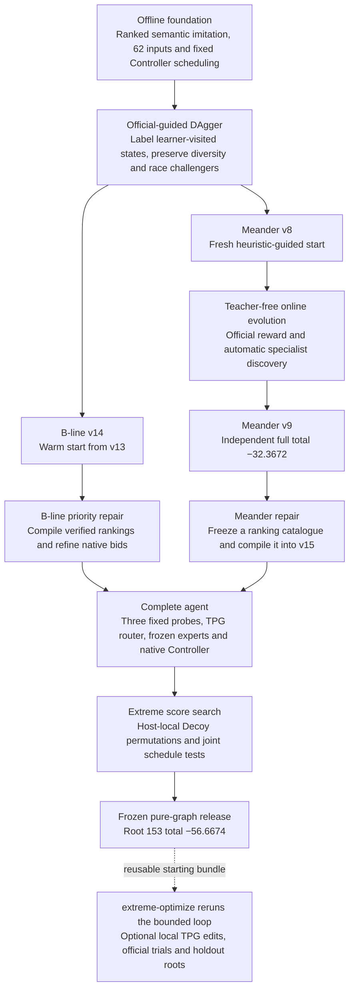

# Validated BES pipeline for CAGE2

The maintained route is **offline policy representation → official-guided DAgger → teacher-free online evolution → pure-graph deployment → extreme optimization**. The frozen complete agent scored **−56.6674** on official root 153. The run used the original CAGE2 ChallengeWrapper on patched CybORG 2.1, three TPG graphs and the native Controller.

The diagram follows checkpoint handoffs. B-line v14 and Meander v8 came out of the same training method with different starts. The successful teacher-free online promotion in this lineage was Meander v8 → v9. Later experimental repair candidates and the final B-line expert have their own provenance.

## Flowchart

## 1. Offline foundation

| Method | Purpose | Verified effect |
| --- | --- | --- |
| Fixed-order Decoy control and ranked offline imitation | Separate host/response selection from option availability. Label rankings and let the Controller pick an executable action. | In the early 2×2 offline comparison, fixed order beat evolved order at both input widths. At 62 inputs the full total was −1068.918 with fixed order and −1278.839 with evolved order. The large losses motivated training on the learner's own trajectories. |
| Offline initialization followed by official online fine-tuning | Start graph search from a policy that already has task-relevant behavior and use environment return to correct accumulated rollout errors. | An early 78-generation fine-tune reached a B-line full total of −127.8733 with Hamming disabled. This is an early handoff result, with its historical action and Controller contract. |
| Semantic-36 and the 62-input contract | Give learners direct `(host, response)` terminals. Use 52 raw values and 10 scan-state values. Leave concrete Decoy selection and bookkeeping with the Controller. | A compiled B-line heuristic fit in one team with 29 learners and 197 instructions and scored −28.9498. This established how much the representation could express. |
| Canonical Controller and corrected fixed Decoy schedule | Align teacher and BES execution with the same availability and state updates. | With the graph held fixed, correcting the schedule changed official full validation from **−41.8542 to −33.2618**. |

The 36 learned categories are nine hosts × Analyse, Remove, Restore and Decoy. The graph proposes up to eight distinct semantic actions. The Controller resolves them into a concrete action and updates scan/Decoy state from the executed action and observed transition. Restore delivery requires first rank. The later ranked-host Decoy scheduler is a distinct change described in section 5.

Sources: [original offline semantic implementation](https://github.com/PopcornBoat/bes/commit/10533ec), [validated route and Controller evidence][validated], [archived patch ledger][ledger]. Early totals and the 78-generation record are in the local `BES-TPG-progress-summary-en.md`, sections 4.1–4.3.

## 2. Official-guided DAgger

DAgger queries the deterministic Lisp heuristic on observations the learner actually visits and adds ranked labels to bounded replay. Teacher queries are side-effect free. A proposed Decoy consumes an option only if it executes. Ranked imitation drives most population evaluations. Closed-loop official returns decide which checkpoint can replace the historical best.

| Method | Purpose | Verified effect |
| --- | --- | --- |
| Grouped epsilon-lexicase | Keep behaviorally complementary specialists when scalar imitation converges to a narrow population. | In a controlled B-line continuation, mean unique Top-1 fingerprints rose from 2.19 to 33.96 and full total improved from **−55.0362 to −46.2352**. |
| Field-local and effective-code-aware mutation with a reduced instruction profile | Spend more search effort on the instructions that produce bids while retaining ordinary learner and graph mutations. | A fresh reduced-profile run reached **−34.0480** in less training time. The operators, instruction profile and categorical constants were used together. |
| Multi-source nomination and bounded official-evidence inheritance | Give aggregate, specialist, behaviorally distinct, critical-error and random candidates access to official screening. Preserve promising parents long enough to reproduce. | The admission-only control had 22 fresh confirmations and zero promotions. The later maintained workflow produced B-line v14 and Meander v8. These endpoints measure the combined workflow. |
| Staged official racing and independent checkpoint copies | Compare on shared seeds, use cheap evaluation to reject clear failures, then advance the winner through fresh seeds, multiple horizons and tail checks. | Full validation can be rerun on a frozen graph. Warm starts rebuild a population from the saved best, and historical-best writes create independent serialized copies. |

The protected B-line continuation reached v13 at **−32.9590** and then v14 at **−28.4841**. V14 came from the evolved incumbent lineage. Across eight fresh 100-step roots, v14 and the compiled heuristic were at a similar level (paired difference **−0.0853 ± 0.1516 SE**). Meander v8 started fresh with its own Lisp heuristic and reached **−39.3888**. A separate validation of that heuristic scored **−40.6329**.

Sources: [controlled selection result](https://github.com/PopcornBoat/bes/blob/f8ab53398bef78937abc5050d17406a5070483a5/EXPERIMENTS.md#completed-phase-4a-and-scalar-control-comparison), [B-line v14][b14], [Meander v8][m8], [DAgger requests](https://github.com/PopcornBoat/bes/blob/offline-dagger/EXPERIMENTS.md#teacher-guided-dagger), [archived patch ledger][ledger].

## 3. Teacher-free online evolution

Warm-start from an independently validated checkpoint and score candidates on official return. The maintained launcher uses one shared training episode per generation and changes the seed each generation. Specialist discovery periodically freezes the incumbent, audits observable state and effective action support, proposes and tests a repair, synthesizes a conditional TPG learner and admits confirmed offspring as bounded evidence anchors. The normal fresh-seed promotion pipeline still decides historical best.

| Method or result | Purpose | Verified effect |
| --- | --- | --- |
| User2 Restore positive control | Verify that a state-conditioned corrective action can close a real policy gap in the existing representation. | The manually constructed Meander specialist gained **+4.7345** on 200 paired 100-step episodes and reduced the observed User2 compromise-marker duration from approximately 63 to 4.4 steps. Its separate standard full validation scored **−32.0889**. |
| Automatic specialist discovery and inheritance | Find and retain useful defensive behavior during ordinary teacher-free search. | The first Meander promotion was from an automatically nominated and synthesized User2 Restore specialist. Later promotions came from aggregate and random-control candidates. The run froze **Meander v9** at generation 446. Independent totals improved from v8 **−39.3888** to v9 **−32.3672**, with most of the +7.0216 gain at 50 and 100 steps. |
| Local priority edits evaluated as complete policies | Change a bid only where a replacement has credible behavioral and reward evidence. Evaluate the repeated effect in a closed-loop rollout. | The native B-line `credit-02` checkpoint changed two constant bids in one terminal team, with the compiled parent as the control. It improved **−27.6511 → −27.1391** on 3,000 fresh paired episodes, with 512 wins, 2,488 ties and zero losses. |
| Narrow repair validated on independent seeds | Test targeted graph edits where archived failures suggest a missed defensive response. | An experimental B-line User2 Remove graph gained **+0.0940** in the three-horizon full sum (nominal unadjusted 95% CI `[+0.00092, +0.18708]`). A Meander Enterprise2 Analyse graph won three of 5,000 independent 100-step pairs and tied the rest, with +0.1046 mean and two avoided below-−100 episodes. These are frozen research candidates. |

The continuous official search branch verified automated candidate generation, retention and evaluation. Its independent replication judged the latest B-line lineage gain over its actual starting checkpoint unconfirmed. The v9 result and the narrower closed-loop controls above support specific improvements. The observed lineage gain depends on the candidate and its confirmation cohort.

Sources: [teacher-free launcher and search][online], [Meander v9][m9], [manual positive control](https://github.com/PopcornBoat/bes/blob/a26722d15e60674c93886fc84340e38de681535e/docs/user2-specialist-validation.md). Local primary evidence includes `frozen-checkpoints/bline-credit-02/` and `runtime/window-repair-full-validation-20261118/`.

## 4. From separate experts to a complete pure-graph agent

1. **Use matched trajectory disagreements to find candidate repairs.** Freeze proposed host/response ranking changes learned from observed disagreements, then evaluate repeated application on new trajectories. In the standalone explicit-seed tests, B-line's combined rank repair scored **−28.0739 / −27.8215** at roots 153 / 42, against v14 **−28.4841 / −28.4322**. The frozen Meander combined repair scored **−30.6782 / −31.4670**, against v9 **−32.3307 / −32.2975**. These were route-assisted results. The local reports identify the observation and remaining-Decoy conditions.
2. **Test history-dependent priorities separately.** The B-line experiment searched previous observable features for a predicate that decides when to prioritize Enterprise0 Restore over Analyse. Its automatically selected rule improved fresh paired full validation from **−27.3449 to −26.9539**. This path used a history guard at inference time and helped identify a real priority conflict. The final pure-graph agent runs without that guard.
3. **Learn the opponent router as a separate TPG.** The Controller executes `51 → 116 → 55`, queries the classifier once at decision index 3, then dispatches B-line, Meander or the benign Sleep action for the rest of the episode. The complete-agent test correctly routed **9,000/9,000** episodes. The repaired dispatch combination scored **−57.7761** versus **−60.8513** for the older v14/v9 dispatch combination on the same explicit episode schedule. The repaired combination scored **−58.0797** under continuous resets.
4. **Compile the runtime ranking correction into the native graph.** The Meander v15 freeze encodes the tested ranking catalogue as native TPG learner programs and routes, evaluated on the existing 62 inputs. The compiled and external-catalogue arms produced byte-identical concrete actions and identical returns across **540,000 transitions** on continuous root 153. With the B-line expert also using its native graph and the ranked-host Controller, the pure-graph full total was **−57.2553**. The 62-vector, the two expert graphs and the router are sufficient for this tested deployment.

The [experiment log][experiments] records the evaluation workflow. Local report paths below start at `bes-artifacts/`.

| Transition | Local evidence |
| --- | --- |
| Frozen repairs under explicit episode seeds | `runtime/{bline,meander}-ppo-route-root153-20261113/full-root{153,42}/REPORT.md` |
| B-line previous-observation experiment | `runtime/bline-restore-context-policy-20261116/fresh/REPORT.md` |
| Complete dispatch and continuous-reset comparisons | `runtime/bes-opponent-dispatch-best-20261116/full/results.json` and `runtime/full-agent-validation-20261120/` |
| Meander v15 compilation | `frozen-checkpoints/meander-v15/`, especially `root153-comparison.json` and `paired-trace-sha256.json` |

## 5. Extreme optimization and the frozen result

For the final expert graphs, the ranked-host scheduler takes Decoy hosts in Top-8 proposal order, uses each host's available local options in table order, and resumes the ordinary non-Decoy fallback after exhaustion. Host-priority semantics and host-local option order are separate. Older expert graphs can depend strongly on their original fallback, so schedule comparisons use the matching frozen graph and Controller.

| Method | Purpose | Verified effect |
| --- | --- | --- |
| All-host single permutation sweep | With the three graphs frozen, optimize option ordering without changing the TPG's decision on which hosts to propose. | 117 complete evaluations including the baseline. Root 153 improved from **−57.2553 to −56.7823** with Enterprise0 order `[6,7,2,0]`. The same winner gained **+0.6323** at root 42 and **+0.0794** at root 2026 versus that root's original table. |
| Joint testing of high-scoring orders | Measure interaction across hosts by scoring the combination in the simulator. | Enterprise0 `[6,2,0,7]` with Defender `[7,2,0,6]` reached **−56.6674** on root 153. The improvement was **+0.5879** over the pure-graph baseline and **+0.1149** over the best single-host table. The root 42/2026 checks above belong to the single-host winner. |
| Native Restore graph for selected rare losses | Make a narrowly scoped corrective response available while executing only the graph and Controller. | A separate Meander Restore graph matched all 9,000 returns of the **−56.6674** release on root 153. It improved two rare 100-step loss trajectories on six additional roots. The mean full-score change was **+0.0191 ± 0.0440 SE**. This supports a tail effect on those trajectories, with an uncertain average effect. |
| Automated `extreme-optimize` mode | Repeat schedule search, shortlisted joint tests, optional native ranking edits, official evaluation and holdout screening from a frozen bundle. | The maintained implementation passed small official trajectory-parity, checkpoint reload and resume tests. It kept the original bundle when a root-153 candidate deteriorated on its holdout. The full-scale score gain above came from the separately archived sweep and joint study. |

The final record is a **whole-agent** total using continuous resets, 1,000 episodes per horizon and opponent, and CybORG revision `26ce1c1253fa9e2e73f25e6a7f2da32860c11257`. It comprised 9,000 episodes and 540,000 interactions. Root 153 was used to select the winning schedule.

| Opponent | 30 steps | 50 steps | 100 steps | Subtotal |
| --- | ---: | ---: | ---: | ---: |
| B-line | −3.8909 | −7.0414 | −14.9884 | −25.9207 |
| Meander | −5.4586 | −8.6887 | −16.5994 | −30.7467 |
| Sleep | 0.0000 | 0.0000 | 0.0000 | 0.0000 |
| **Combined** | | | | **−56.6674** |

There were zero returns below −100 in that run. On the same official protocol and root, Cardiff's local `90000.pth` complete agent scored **−57.5474**. The measured difference was **+0.8800** for BES, with +0.9896 from B-line and −0.1096 from Meander.

Sources: [ranked-host Controller implementation](https://github.com/PopcornBoat/bes/commit/cfee01acb1770a7a77130093145454e4a48cd704), [complete-agent experiment log][experiments]. The primary local record is `frozen-checkpoints/root153-e0-defender-combined-20261123/evidence/winning-record.json`. The final figure and archive report are in `reports/bes-final-policy-analysis-20261124/`. See [optimizer usage](../scripts/bes_extreme/README.md) and the [pinned release](https://github.com/PopcornBoat/bes/tree/release/cage2-root153-v1).

## Reproduction and score comparisons

- **Training references:** [offline-dagger](https://github.com/PopcornBoat/bes/tree/offline-dagger) uses `:official-guided`. [online-official-specialists](https://github.com/PopcornBoat/bes/tree/online-official-specialists) uses `:official-online`. The checkpoint READMEs record the applicable historical Controller profiles.
- **Complete-agent reproduction:** use the final frozen bundle, its `SHA256SUMS` and `validate.py` with `--seed 153`. Record the simulator revision, reset protocol, graph and Controller hashes, and every cell mean. Match the root and configuration for both arms. Continuous-reset comparisons pair full roots. Explicit episode-seed experiments pair individual episodes.
- **Safe compression:** effective-code analysis and conservative pruning reduce stored code. For example, the final Meander copy fell from 198,901 to 123,636 instructions and preserved rankings on 970,000 archived decisions. This is measured compression with archive parity. The separate `-pruned` release has its own hashes and no newly measured full total.

Only compare totals at the same scope. A standalone opponent total sums three horizon means, the complete agent sums nine, and dashboard imitation/reference fitness uses its own evaluation bank.

[validated]: https://github.com/PopcornBoat/bes/blob/online-official-specialists/validated-checkpoints/README.md
[b14]: https://github.com/PopcornBoat/bes/blob/offline-dagger/validated-checkpoints/bline-v14/README.md
[m8]: https://github.com/PopcornBoat/bes/blob/offline-dagger/validated-checkpoints/meander-v8/README.md
[m9]: https://github.com/PopcornBoat/bes/blob/online-official-specialists/validated-checkpoints/meander-v9/README.md
[online]: https://github.com/PopcornBoat/bes/blob/online-official-specialists/experiments/teacher-free-online-specialists.md
[ledger]: https://github.com/PopcornBoat/bes/blob/530325d/docs/patch-evidence.md
[experiments]: https://github.com/PopcornBoat/bes/blob/main/EXPERIMENTS.md
